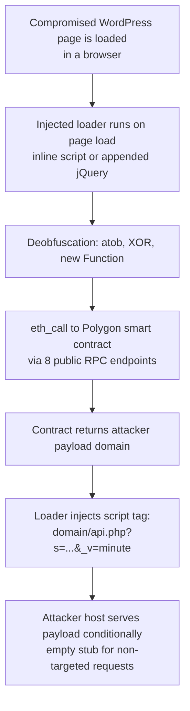

# EtherHiding Technique: Blockchain Loader on a Compromised WordPress Site

**Technique:** EtherHiding (payload domain stored in a Polygon smart contract)

---

## Contents

- [EtherHiding Technique: Blockchain Loader on a Compromised WordPress Site](#etherhiding-technique-blockchain-loader-on-a-compromised-wordpress-site)
  - [Contents](#contents)
  - [1. Summary](#1-summary)
  - [2. Case overview](#2-case-overview)
  - [3. What was and was not established](#3-what-was-and-was-not-established)
  - [4. Methodology and evidence](#4-methodology-and-evidence)
  - [5. Environment](#5-environment)
  - [6. File details](#6-file-details)
  - [7. Technical analysis of the injected loader](#7-technical-analysis-of-the-injected-loader)
    - [7.1 Loader chain](#71-loader-chain)
    - [7.2 Two injection variants](#72-two-injection-variants)
    - [7.3 Decoded behaviour (page variant, 2,037 bytes)](#73-decoded-behaviour-page-variant-2037-bytes)
    - [7.4 Why EtherHiding matters here](#74-why-etherhiding-matters-here)
  - [8. Behaviour assessment](#8-behaviour-assessment)
  - [9. MITRE ATT\&CK mapping](#9-mitre-attck-mapping)
  - [10. Final assessment](#10-final-assessment)
  - [11. Indicators of compromise](#11-indicators-of-compromise)

---

## 1. Summary

The website (a WordPress site, name withheld) is compromised and serves an obfuscated JavaScript loader that uses **EtherHiding**: the attacker's payload domain is not hard-coded, but stored in a smart contract on the Polygon blockchain and resolved at runtime.

Key points:

- The quarantined scholarship page (`/scholarship-program/`) is identical to the copy fetched from the internet at the time of analysis. It contains an obfuscated inline script (`atob` → XOR `0x7C` → `new Function`) that decodes to a blockchain-based loader. The loader queries **8 public Polygon RPC endpoints**, calls smart contract `0xB6bC…C1f2` with selector `0xb68d1809`, ABI-decodes a URL from the result and loads `<url>/api.php?s=…&_v=<minute>` as a remote script.
- A live `eth_call` returned the attacker's payload domain, `hxxps://enter-press-cdn[.]info` (`178.16.52[.]101`, nginx, `application/javascript`, CORS `*`). The endpoint returned HTTP 200 and an empty stub (`(function(){})();`) to a non-targeted request, which is consistent with conditional or targeted payload serving.
- The site's **jQuery 3.7.1 file is also injected**. The flagged file (90,553 bytes, MD5 `eec66380d4ffba47c3508996248d0912`) is byte-identical to the site's live jQuery file and has an obfuscated blob of the same loader appended (XOR `0x2E` variant). This is why the on-access scanner flagged it: legitimate jQuery with malicious code appended.
- The **homepage carried the same inline loader** at analysis time, so the compromise appears site-wide, or at least spans multiple pages and theme assets.

## 2. Case overview

| Field | Value |
|---|---|
| Host | `lab-lt01` |
| IP / domain | `10.2.x.x` / `labdomain` |
| Time | 2026-01-03 05:28:07 UTC |

## 3. What was and was not established

| Status | Finding |
|---|---|
| ✅ Confirmed | The website serves injected JavaScript in the scholarship page, the homepage and the theme's jQuery file |
| ✅ Confirmed | The quarantined files contain the loader; their hashes match the live site content |
| ✅ Confirmed | The smart contract returns the payload domain (live `eth_call`) |
| ✅ Confirmed | The payload host is live and serves JavaScript; it returned an empty stub to a non-targeted request |

## 4. Methodology and evidence

| # | Source | Evidence | Result |
|---|---|---|---|
| 1 | Endpoint agent | Detection record | On-access-scan detection; actor `msedge.exe` PID 17348; the first quarantine attempt **failed** (error `a0000001`) and the file was later quarantined successfully |
| 2 | Quarantine-acquire package | Scholarship page HTML (39,628 B) | Page is `/scholarship-program/` of the compromised site; contains an obfuscated inline loader |
| 3 | Static analysis of the JavaScript | Python deobfuscation | `atob` → XOR (`0x7C`) → `new Function`; decoded loader queries Polygon RPCs and contract `0xB6bC9e1D…` to load an `api.php` payload |
| 4 | Verification | `eth_call` to the contract via a public Polygon RPC (`1rpc.io/matic`) | Returned the ABI-encoded string `https://enter-press-cdn.info` |
| 5 | Verification | `enter-press-cdn.info` (`178.16.52.101`) | nginx, HTTP 200, `application/javascript`, CORS `*`; `/api.php?...` returned an empty stub (conditional serving) |

## 5. Environment

| Attribute | Value |
|---|---|
| Hostname | `lab-lt01` |
| Hardware | Laptop |
| IPv4 | `10.2.x.x` |
| Domain / user | `labdomain` / `labdomain\user-1` |
| Security stack | Built-in OS antivirus |
| Browser | Microsoft Edge 141.0.3537.99 (Chrome 141.0.7390.123 also installed) |
| Compromised site | WordPress 7.0.2, custom theme (name withheld) |
| Payload host | `enter-press-cdn[.]info` (`178.16.52[.]101`), live, nginx |

## 6. File details

| Field | Value |
|---|---|
| Infected file | `jquery-3.7.1.min.js`, 90,553 B, MD5 `eec66380d4ffba47c3508996248d0912`, with an appended injected blob |
| Related quarantined file | Scholarship page, MD5 `f2d1a51697de77954772a63f5b038b1b`, with the inline injected loader |
| Actor | `msedge.exe` PID 17348, user `labdomain\user-1` |
| Time | 2026-01-03 05:28:07 UTC |

## 7. Technical analysis of the injected loader

### 7.1 Loader chain

### 7.2 Two injection variants

The same loader appears twice with different obfuscation keys.

| Element | Page inline variant | jQuery-appended variant |
|---|---|---|
| Location | `<script>` block of the scholarship page | End of `jquery-3.7.1.min.js` |
| Obfuscation | `atob` → XOR `0x7C` → `new Function(...)` | `atob` → XOR `0x2E` → `new Function(...)` |
| Guard flag | `window['_b60bdf6be6']` | `window['_2027709754']` |
| Contract (Polygon) | `0xB6bC9e1D0b2fB96Ab7C47E04Cb0BE477410bC1f2` | same |
| Function selector | `0xb68d1809` | same |
| Client suffix (`s=`) | `8402fb1338daab6a166e91aa8c92a20798acfa98fb75c5a2` | same |
| Payload URL pattern | `<domain>/api.php?s=<suffix>&_v=<unix-minute>` | same |

### 7.3 Decoded behaviour (page variant, 2,037 bytes)

1. Query each of 8 Polygon RPC endpoints with `eth_call {to: 0xB6bC9e1D…, data: 0xb68d1809}`:
   `rpc-mainnet.matic.quiknode.pro`, `polygon-mainnet.public.blastapi.io`, `polygon.gateway.tenderly.co`, `1rpc.io/matic`, `polygon-public.nodies.app`, `polygon-bor-rpc.publicnode.com`, `polygon.drpc.org`, `rpc.ankr.com/polygon`.
2. ABI-decode the returned string (offset `0x20`, length-prefixed).
3. On success, inject `<script src="<decoded-domain>/api.php?s=8402fb13…&_v=<minute>">` into the page.

Live `eth_call` result, decoded: `https://enter-press-cdn.info` (a 28-byte string, hex `68747470733a2f2f656e7465722d70726573732d63646e2e696e666f`).

### 7.4 Why EtherHiding matters here

This is the **EtherHiding** technique (described by Guardio Labs in 2023): malware infrastructure is hidden in blockchain smart contracts, so the C2 or payload domain survives takedowns and cannot be blocked by static URL lists alone. Because the attacker can change the domain by updating the contract, domain blocking is a stop-gap rather than a fix. Payloads delivered in this campaign family are typically fake browser update, fake CAPTCHA or tech-support-scam scripts, or crypto-wallet drainers. The payload itself was not retrieved, so this is an expectation based on the family and not an observation.

## 8. Behaviour assessment

| Behaviour | Assessment |
|---|---|
| Site-side delivery | Injected JavaScript in the page and in the theme's jQuery file |
| Execution (host) | Not verifiable: no network telemetry for the incident window, and no evidence that the loader ran or fetched the payload on `lab-lt01` |
| Obfuscation | `atob` + XOR + `new Function` in both variants; evades simple static detection |
| C2 / staging | Blockchain (Polygon) used to store and retrieve the payload domain; resistant to takedown |
| Persistence (host) | None observed: no new services, autoruns, scheduled tasks or processes |
| Network (host) | Unavailable for the incident window: RPC or payload connections can be neither confirmed nor denied |

## 9. MITRE ATT&CK mapping

| Tactic | Technique | ID | Evidence | Confidence |
|---|---|---|---|---|
| Initial Access | Drive-by Compromise | T1189 | Compromised WordPress site serving injected JS | High (infrastructure) |
| Execution | Command and Scripting Interpreter: JavaScript | T1059.007 | Loader executes via `new Function` in the browser | High (malicious code) / Medium (host execution) |
| Defense Evasion | Obfuscated Files or Information | T1027 | `atob` + XOR + eval chains (keys `0x7C` / `0x2E`) | High |
| Command and Control | Application Layer Protocol: Web Protocols | T1071.001 | HTTPS `api.php` payload fetch | High (infrastructure) / Medium (host) |
| Command and Control | Web Service: Dead Drop Resolver | T1102.001 | Payload domain resolved at runtime from a blockchain smart contract | High (infrastructure) / Medium (host) |
| Resource Development | Stage Capabilities: Upload Malware | T1608.001 | Payload staged on an attacker-controlled host behind `api.php` | High (infrastructure) |
| Resource Development | Compromise Infrastructure / Obtain Capabilities | T1584 / T1588 | Compromised WordPress site; EVM-compatible contract used for staging | High (infrastructure) |
| Impact (potential) | n/a | n/a | Payload not obtained (conditional serving); likely fake browser update, tech-support scam or crypto drainer | Unknown |

No host-side persistence, privilege escalation, credential access or lateral movement was observed.

## 10. Final assessment

The compromised website serves an EtherHiding blockchain-based JavaScript loader, injected into the scholarship page, the homepage and the theme's jQuery file. The detection on `lab-lt01` accurately flagged malicious code in the site's jQuery file. The loader's payload domain (`enter-press-cdn[.]info`, `178.16.52[.]101`) is live, but the payload is served conditionally and could not be retrieved for final characterization. No evidence was found that the host was infected.

**Limitations.** The conclusion on host impact is bounded by missing telemetry: network events for the incident window and browser DNS logs were unavailable. The assessment of the payload's nature rests on the loader's family and behaviour, not on a retrieved sample.

---

## 11. Indicators of compromise

IOCs are defanged (`hxxps`, `[.]`). Refang before use in tooling.

| Type | Value |
|---|---|
| Compromised site | `(redacted)`: homepage, `/scholarship-program/`, custom theme assets |
| Scholarship page hash | MD5 `f2d1a51697de77954772a63f5b038b1b` · SHA256 `01320cd4fbab4203ac5f221bb7c08d6368af586050b80247b4df5951786b06fe` |
| Injected jQuery hash | MD5 `eec66380d4ffba47c3508996248d0912`; the official jQuery 3.7.1 min file is MD5 `2c872dbe60f4ba70fb85356113d8b35e`, so this is a different file |
| Payload domain | `enter-press-cdn[.]info` (`178.16.52[.]101`, nginx) |
| Payload URL pattern | `hxxps://enter-press-cdn[.]info/api.php?s=8402fb1338daab6a166e91aa8c92a20798acfa98fb75c5a2&_v=<unix-minute>` |
| Blockchain contract (Polygon) | `0xB6bC9e1D0b2fB96Ab7C47E04Cb0BE477410bC1f2`, selector `0xb68d1809` |
| RPC endpoints used | `rpc-mainnet.matic.quiknode.pro`, `polygon-mainnet.public.blastapi.io`, `polygon.gateway.tenderly.co`, `1rpc.io/matic`, `polygon-public.nodies.app`, `polygon-bor-rpc.publicnode.com`, `polygon.drpc.org`, `rpc.ankr.com/polygon` |
| Guard flags | `window['_b60bdf6be6']`, `window['_2027709754']` |
