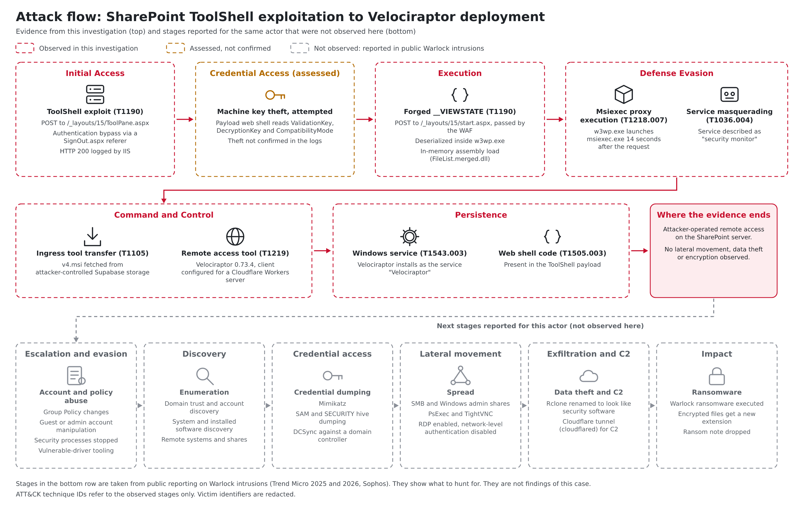
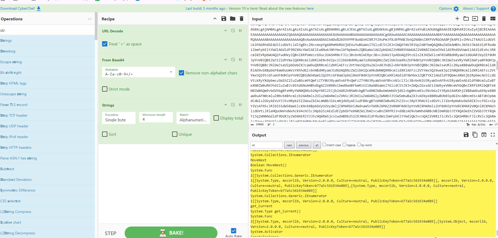
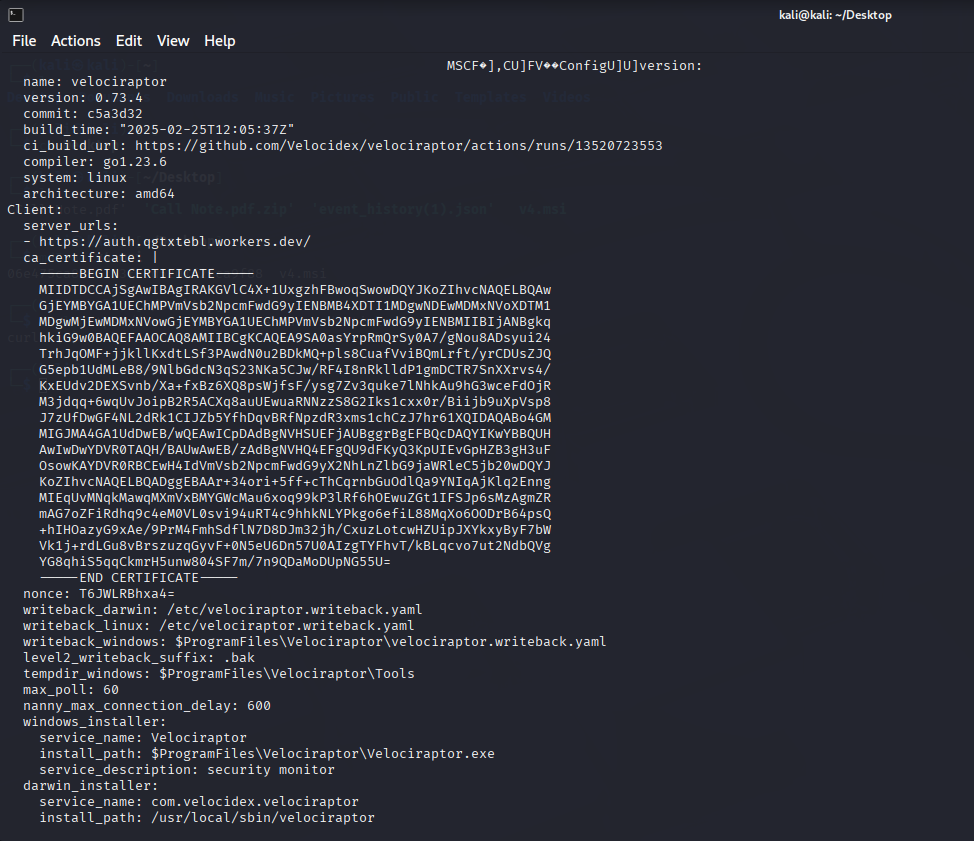

# Cyber Investigation: SharePoint ToolShell Exploitation Leading to Velociraptor Deployment

**Vulnerability:** ToolShell (CVE-2025-53770, CVE-2025-53771, chained with CVE-2025-49704 / CVE-2025-49706) · **Activity window:** 2025-10-19 to 2025-10-22 · **Assessed actor:** Warlock ransomware operators (moderate-to-high confidence, infrastructure shared with published analysis)

> **Handling.** Sanitized for sharing. The victim organisation, hostnames, internal IP addresses, application pool and site names, and personal details are redacted as `(redacted)`. Attacker infrastructure is published in defanged form (`hxxps`, `[.]`). Screenshots from the original report that show victim identifiers are omitted.

---

## Contents

1. [Executive summary](#1-executive-summary)
2. [Case overview](#2-case-overview)
3. [Findings and confidence](#3-findings-and-confidence)
4. [Evidence and methodology](#4-evidence-and-methodology)
5. [Attack flow](#5-attack-flow)
6. [Technical analysis](#6-technical-analysis)
7. [Source IP addresses](#7-source-ip-addresses)
8. [MITRE ATT&CK mapping](#8-mitre-attck-mapping)
9. [Attribution assessment](#9-attribution-assessment)
10. [Indicators of compromise](#10-indicators-of-compromise)
11. [References](#11-references)

---

## 1. Executive summary

An internet-facing, on-premises Microsoft SharePoint Server was attacked through the **ToolShell** exploit chain on two days, three days apart.

- **19 October 2025.** One source IP sent a `POST` to `/_layouts/15/ToolPane.aspx` that matches the public ToolShell exploit. The payload carries a web shell component that reads the server's ASP.NET machine keys (`ValidationKey`, `DecryptionKey`) and `CompatibilityMode`. The web server logged HTTP 200.
- **22 October 2025.** A second source IP sent three `POST` requests to `/_layouts/15/start.aspx` with a large, malicious `__VIEWSTATE` that deserializes into in-memory .NET code. The WAF passed them. Fourteen seconds later the SharePoint IIS worker process (`w3wp.exe`) launched `msiexec.exe`.
- The worker process then fetched `v4.msi` from an attacker-controlled Supabase storage bucket. Microsoft Defender detected it. The installer deployed **Velociraptor**, an open-source incident-response tool, configured to connect to a Cloudflare Workers domain. This gives the attacker remote command execution and persistent access.

A forged `__VIEWSTATE` that the server accepts normally requires the machine keys. The 22 October activity is therefore **consistent with** the keys having been stolen on 19 October. This is an inference. It is not confirmed by the logs.

The delivery step matches published **Warlock** reporting. Trend Micro's analysis of a Warlock intrusion describes `w3wp.exe` launching `msiexec.exe` to install `v4.msi`, a Velociraptor installer, from the same Supabase storage project that appears here. **No ransomware, encryption or ransom note appears in the evidence reviewed.** What was established is a confirmed intrusion with attacker-controlled remote access, at the stage that precedes ransomware in the published cases.

**Severity: Critical.** The server is compromised and the machine keys are assessed as exposed.

## 2. Case overview

| Field | Value |
|---|---|
| Incident type | Exploitation of a public-facing application, followed by remote-access tooling |
| Affected system | On-premises Microsoft SharePoint Server, internet-facing, behind an F5 ASM WAF |
| Organisation / hosts | (redacted) |
| Vulnerability | ToolShell: CVE-2025-53770 (RCE), CVE-2025-53771, with CVE-2025-49704 / CVE-2025-49706 |
| First observed | 2025-10-19, `POST /_layouts/15/ToolPane.aspx` from `185.100.87[.]156` |
| Code execution observed | 2025-10-22, `w3wp.exe` → `msiexec.exe`, following a `POST /_layouts/15/start.aspx` from `192.121.162[.]45` |
| Detection | WAF and IIS logs in OpenSearch, Microsoft Defender telemetry |
| Post-exploitation tool | Velociraptor 0.73.4 installed from `v4.msi` |
| Ransomware observed | No |

## 3. Findings and confidence

| Status | Finding |
|---|---|
| ✅ Confirmed | A ToolShell-style `POST` to `/_layouts/15/ToolPane.aspx` from `185.100.87[.]156` on 2025-10-19, logged by IIS with HTTP 200 |
| ✅ Confirmed | A malicious `__VIEWSTATE` payload sent to `/_layouts/15/start.aspx` from `192.121.162[.]45` on 2025-10-22, passed by the WAF |
| ✅ Confirmed | `w3wp.exe` for the SharePoint application pool launched `msiexec.exe` about 14 seconds after that request (Defender) |
| ✅ Confirmed | `v4.msi` was fetched from an attacker-controlled Supabase storage URL, and it installs Velociraptor configured for a `workers.dev` server |
| ✅ Corroborated | The same Supabase storage URL, the installer name `v4.msi` and Velociraptor 0.73.4 appear in Trend Micro's published analysis of a Warlock intrusion (March 2026) |
| 🔶 Assessed | The first payload retrieved the machine keys, which were then used to sign the later `__VIEWSTATE` |
| 🔶 Assessed | The activity was carried out by Warlock operators (infrastructure overlap with published analysis) |
| ❓ Not established | Whether the 19 October request succeeded, and whether the keys were actually taken |
| ❓ Not established | Lateral movement, data theft, Group Policy changes, or ransomware deployment |

## 4. Evidence and methodology

| # | Source | Used for |
|---|---|---|
| 1 | WAF logs (F5 ASM) in OpenSearch | Exploit requests, source IPs, whether the WAF blocked them |
| 2 | IIS web server log | Exact `ToolPane.aspx` request, response code, headers |
| 3 | Microsoft Defender telemetry | Process lineage (`w3wp.exe` → `msiexec.exe`), MSI download, detection time |
| 4 | CyberChef decode of the `__VIEWSTATE` value | URL decode → Base64 decode → string extraction to identify the .NET payload |
| 5 | Static analysis of the Velociraptor installer | Version, build metadata, embedded client configuration, service name |
| 6 | IP geolocation and ownership lookup | Context for the source IPs in section 7 |

## 5. Attack flow

*Figure 1. Attack flow. Top: stages supported by the evidence. Bottom: later stages that public reporting attributes to Warlock intrusions, which were not observed here. A scalable version is in [`images/attack-flow.svg`](images/attack-flow.svg).*

How to read the figure:

- **Red, dashed:** observed in this investigation.
- **Amber, dashed:** assessed from the evidence but not confirmed (machine key theft).
- **Grey, dashed:** not observed. These stages come from published Warlock reporting (Trend Micro 2025 and 2026, Sophos) and show where this intrusion stops. They are not findings of this case.

The observed chain runs from a ToolShell request, through a forged ViewState that executes inside the SharePoint worker process, to an MSI that installs Velociraptor with a Cloudflare Workers server. The evidence ends there.

## 6. Technical analysis

### 6.1 ToolShell request (2025-10-19, 15:27:48 local time)

The IIS log records:

| Field | Value |
|---|---|
| Method and path | `POST /_layouts/15/ToolPane.aspx?DisplayMode=Edit&a=/ToolPane.aspx` |
| Source | `185.100.87[.]156` (also sent as `X-Forwarded-For`) |
| Response | HTTP 200 |
| Request size | `Content-Length: 7582` |
| `Referer` | `/_layouts/SignOut.aspx` (consistent with the publicly described ToolShell authentication bypass) |
| `User-Agent` | A spoofed, outdated Chrome 43 on macOS string |
| Content type | `application/x-www-form-urlencoded` |

The body follows the public ToolShell structure:

- `MSOTlPn_Uri` points at `/_controltemplates/15/AclEditor.ascx`, a SharePoint control used to get the web part parsed.
- `MSOTlPn_DWP` contains `<%@ Register … %>` directives that register tag prefixes for `System.Web.UI` (`System.Web.Extensions`) and `Microsoft.PerformancePoint.Scorecards` (`Microsoft.PerformancePoint.Scorecards.Client`). It then instantiates an `ExcelDataSet` control.
- The control's `CompressedDataTable` property holds a gzip-compressed, Base64-encoded blob (`H4sI…`) that the investigation matched to output from ysoserial-style .NET gadget tooling.
- The payload includes a **web shell component** that retrieves the `ValidationKey`, the `DecryptionKey` and the `CompatibilityMode`. With these an attacker can sign valid ViewState and decrypt protected data, which enables further code execution.

HTTP 200 means the request was processed. The log alone does not show whether the keys were read or sent back.

### 6.2 Forged ViewState (2025-10-22, 20:12:15 local time)

Three `POST /_layouts/15/start.aspx` requests, logged within about one millisecond of each other, arrived from `192.121.162[.]45` and were logged by the WAF as follows:

| Field | Value |
|---|---|
| WAF action | **passed** (`act=passed`), "Successful Request" |
| Response code | 200 |
| Violation rating | 0, no attack type classified |
| `User-Agent` | An outdated Chrome 22 on Windows NT 6.1 string |
| Parameters | `__VIEWSTATE`, `__VIEWSTATEGENERATOR`, `__SCROLLPATH` |

**Decoding `__VIEWSTATE`** (URL decode → Base64 decode → string extraction) showed an abnormally large binary value containing a serialized .NET object graph. The strings indicate in-memory code execution and file-system reconnaissance:

| Indicator | Meaning |
|---|---|
| `System.Reflection.Assembly.Load` | Loads a .NET assembly from memory |
| `System.Activator.CreateInstance` | Instantiates the loaded type at run time |
| `HttpContext`, `HttpRequest`, `HttpResponse` | Lets the loaded code read the request and write the response |
| `DirectoryInfo`, `FileInfo`, `ListDirectory` | File and directory enumeration on the server |
| Embedded assembly `FileList.merged.dll` | Attacker-controlled code run inside the worker process |
| `System.Func`, `IEnumerator`, `get_Current` generic type references | Typical of a .NET deserialization gadget chain |

*Figure 2. CyberChef recipe (URL Decode, From Base64, Strings) applied to the `__VIEWSTATE` value. The highlighted output shows the .NET type names listed above.*

**`__SCROLLPATH`** held the SharePoint virtual directory path (`C:/inetpub/wwwroot/wss/VirtualDirectories/(redacted)/`). It matches the IIS application pool named in the Defender process command line, so the request was handled by the same SharePoint site and app pool that later ran the installer.

Why this points to stolen keys: ViewState is protected by a signature that uses the `ValidationKey`. A server only deserializes an attacker's `__VIEWSTATE` if the signature is valid (unless ViewState MAC validation has been disabled), so a working forged value normally means the attacker holds the machine keys. This fits the 19 October payload that reads those keys.

### 6.3 Post-exploitation (2025-10-22)

| Step | Detail |
|---|---|
| Execution context | `w3wp.exe`, the IIS worker process for the SharePoint application pool |
| Living off the land | `w3wp.exe` launched `msiexec.exe` at 20:12:29, 14 seconds after the request |
| Download | `v4.msi` from `hxxps://vdfccjpnedujhrzscjtq[.]supabase[.]co/storage/v1/object/public/image/v4[.]msi` (Defender alert recorded at 20:16) |
| Why Supabase | Hosting on a legitimate cloud storage service blends in with normal traffic and lowers the chance of early blocking |
| Detection | Microsoft Defender |

### 6.4 Velociraptor installer

| Attribute | Value |
|---|---|
| Tool | Velociraptor, an open-source digital forensics and incident response (DFIR) platform |
| Version and build | 0.73.4, built 2025-02-25 (commit `c5a3d32`, Go 1.23.6, amd64). This is a legitimate public build, which the attacker repackaged |
| Installer MD5 as recorded | `06e475ca8ad5153f53d5201f2fca9f88` (the source does not say whether this is the MSI or the installed binary) |
| Embedded client server URL | `https://auth[.]qgtxtebl[.]workers[.]dev/` (Cloudflare Workers) |
| Windows service | Name `Velociraptor`, description **"security monitor"**, which masquerades as a benign service |
| Install path | `%ProgramFiles%\Velociraptor\Velociraptor.exe`, tools in `%ProgramFiles%\Velociraptor\Tools` |
| Embedded trust | The client carries its own CA certificate and talks to the server over HTTPS |

*Figure 3. Velociraptor 0.73.4 build metadata and client configuration from the installer, showing the `workers.dev` server URL, the service name and the "security monitor" description.*

Using a legitimate DFIR tool is deliberate. It is signed and widely trusted, so some products do not flag it. Once the client connects, an operator can:

- Run remote commands.
- Collect sensitive data.
- Perform system reconnaissance.
- Run Velociraptor Query Language (VQL) queries.
- Keep persistent access across the environment.

Because Velociraptor is a legitimate tool, the evidence that identifies this activity is its unexpected installation by the SharePoint worker process and the server it contacts, not the tool itself.

## 7. Source IP addresses

The original investigation flagged the following IPs as attempting ToolShell exploitation. Only the first two are tied to specific events in the evidence. The others are listed without per-request evidence in the source.

| IP | Country | Organisation | Tied to evidence |
|---|---|---|---|
| `185.100.87[.]156` | Romania | FlokiNET | Yes: 19 Oct `ToolPane.aspx` request |
| `192.121.162[.]45` | Japan | M247 Europe / EDIS | Yes: 22 Oct `start.aspx` ViewState request |
| `174.138.92[.]189` | United States | DigitalOcean | No |
| `142.93.220[.]243` | India | DigitalOcean | No |
| `138.201.140[.]70` | Germany | Hetzner | No |
| `91.196.152[.]130`, `91.196.152[.]131`, `91.196.152[.]255` | France | ONYPHE | No |
| `195.184.76[.]41`, `195.184.76[.]249`, `195.184.76[.]251`, `195.184.76[.]252`, `195.184.76[.]253` | United States | ONYPHE | No |
| `57.141.16[.]72` | United States | Meta Platforms | No |

ONYPHE is an internet-exposure scanning service, and the Meta address may be crawler traffic, so these are weak indicators of attacker infrastructure. Blocking them is low-cost, but do not treat them as threat-actor attribution. Treat the two hosting-provider IPs in the first rows as the high-confidence sources.

## 8. MITRE ATT&CK mapping

| Tactic | Technique | ID | Evidence | Confidence |
|---|---|---|---|---|
| Initial Access | Exploit Public-Facing Application | T1190 | ToolShell `ToolPane.aspx` request; forged ViewState to `start.aspx` | High |
| Persistence | Server Software Component: Web Shell | T1505.003 | Web shell component in the `ToolPane.aspx` payload | Medium |
| Credential Access | Unsecured Credentials (closest fit for ASP.NET machine keys) | T1552 | Payload reads `ValidationKey` and `DecryptionKey` | Medium (attempted; theft not confirmed) |
| Defense Evasion | Obfuscated Files or Information | T1027 | Gzip + Base64 gadget blob; compressed and encoded `__VIEWSTATE` | High |
| Defense Evasion | System Binary Proxy Execution: Msiexec | T1218.007 | `w3wp.exe` → `msiexec.exe` installing `v4.msi` | High |
| Defense Evasion | Masquerading: Masquerade Task or Service | T1036.004 | Service described as "security monitor" | Medium |
| Resource Development | Stage Capabilities: Upload Malware | T1608.001 | MSI staged in attacker Supabase storage | High |
| Command and Control | Ingress Tool Transfer | T1105 | Installer downloaded from Supabase | High |
| Command and Control | Remote Access Software | T1219 | Velociraptor client used as the remote-access tool | High |
| Command and Control | Web Service | T1102 | Velociraptor server hosted on Cloudflare Workers | Medium |
| Persistence | Create or Modify System Process: Windows Service | T1543.003 | Velociraptor installs as a Windows service | Medium (from installer configuration) |

No lateral movement, data exfiltration, defense impairment or encryption (impact) was observed in the evidence provided.

## 9. Attribution assessment

**Assessment: Warlock ransomware operators (tracked by Microsoft as Storm-2603 and by Sophos as GOLD SALEM). Confidence: moderate to high.**

Reasons:

- **Shared infrastructure.** Trend Micro's [analysis of a Warlock intrusion](https://www.trendmicro.com/en_us/research/26/c/dissecting-a-warlock-attack.html) (published March 2026) names the same Supabase storage host and path, `vdfccjpnedujhrzscjtq[.]supabase[.]co/storage/v1/object/public/image/v4[.]msi`. It describes the same step: `w3wp.exe` launching `msiexec.exe` to install a Velociraptor installer disguised as `v4.msi`.
- **Shared tooling.** That report also names Velociraptor 0.73.4, the version recovered from the installer here.
- **Same entry method.** ToolShell against an internet-facing SharePoint server is the documented way Warlock operators gain access (Microsoft, Sophos, Trend Micro).
- **Known actor behaviour.** Cisco Talos describes Storm-2603 abusing Velociraptor ahead of ransomware deployment.

Limits:

- The comparison is against published reporting. Trend Micro links a separate indicator list, which was not compared against this case.
- Shared infrastructure shows the same operators or toolkit. It does not show that the two reports describe the same victim, and this report makes no such claim.
- The Velociraptor server here (`auth[.]qgtxtebl[.]workers[.]dev`) is a Cloudflare Workers host. The Trend Micro report as read does not name it, and other public reports name different randomized `workers.dev` hosts.
- **No ransomware activity is evidenced in this case.** The correct statement is "pre-ransomware intrusion attributed to Warlock operators", not "Warlock ransomware infection". If encryption, ransom notes or data-theft evidence exists, add it to this report.

## 10. Indicators of compromise

IOCs are defanged (`hxxps`, `[.]`). Refang before use in tooling. Values marked † were transcribed from screenshots, so confirm them against the original evidence.

| Type | Value |
|---|---|
| Source IP (exploitation) | `185.100.87[.]156` (19 Oct), `192.121.162[.]45` (22 Oct) |
| Other flagged IPs | See section 7 (low confidence; includes scanning services) |
| Payload staging URL | `hxxps://vdfccjpnedujhrzscjtq[.]supabase[.]co/storage/v1/object/public/image/v4[.]msi` |
| Velociraptor C2 (client config) † | `hxxps://auth[.]qgtxtebl[.]workers[.]dev/` |
| File name | `v4.msi` |
| Hash | MD5 `06e475ca8ad5153f53d5201f2fca9f88` (Velociraptor installer or binary, as recorded) |
| Velociraptor build | Version 0.73.4, build time 2025-02-25T12:05:37Z, commit `c5a3d32` † |
| Service | Name `Velociraptor`, description `security monitor` † |
| Install path | `%ProgramFiles%\Velociraptor\Velociraptor.exe` † |
| In-memory assembly | `FileList.merged.dll` (embedded in the forged `__VIEWSTATE`) |
| Process lineage | `w3wp.exe` → `msiexec.exe` (installing an MSI from a URL) |
| Exploit request (19 Oct) | `POST /_layouts/15/ToolPane.aspx?DisplayMode=Edit&a=/ToolPane.aspx` with `Referer: /_layouts/SignOut.aspx`, `MSOTlPn_Uri=/_controltemplates/15/AclEditor.ascx`, `Content-Length: 7582` |
| Exploit request (22 Oct) | `POST /_layouts/15/start.aspx` with `__VIEWSTATE`, `__VIEWSTATEGENERATOR`, `__SCROLLPATH` |
| User-Agent strings (spoofed) | Chrome 43 on Mac OS X 10_10_3; Chrome 22 on Windows NT 6.1 |

## 11. References

Patch information from the original report:

- Microsoft: [SharePoint Enterprise Server 2016, July 8 2025 update (KB5002744)](https://support.microsoft.com/en-us/topic/description-of-the-security-update-for-sharepoint-enterprise-server-2016-july-8-2025-kb5002744-9196e240-c76d-4bb0-b16c-6f7d6645a1f0)
- Microsoft: [SharePoint Server 2019, July 8 2025 update (KB5002741)](https://support.microsoft.com/en-us/topic/description-of-the-security-update-for-sharepoint-server-2019-july-8-2025-kb5002741-d860f51b-fcdf-41e4-89de-9ce487c06548)

Public context on ToolShell and the Storm-2603 / Warlock playbook. These describe other incidents and are not evidence from this case:

- Trend Micro: [Dissecting a Warlock attack](https://www.trendmicro.com/en_us/research/26/c/dissecting-a-warlock-attack.html) (March 2026). The `v4.msi` and Supabase overlap, and the 15-day timing, come from this report.
- Trend Micro: [Warlock ransomware](https://www.trendmicro.com/en_us/research/25/h/warlock-ransomware.html) (2025). The later stages in Figure 1 are drawn from this report and the 2026 one.
- Sophos: [GOLD SALEM tradecraft for deploying Warlock ransomware](https://www.sophos.com/blog/gold-salem-tradecraft-for-deploying-warlock-ransomware)
- Cisco Talos: [Velociraptor leveraged in ransomware attacks](https://blog.talosintelligence.com/velociraptor-leveraged-in-ransomware-attacks/)
- The Hacker News: [Hackers turn Velociraptor DFIR tool](https://thehackernews.com/2025/10/hackers-turn-velociraptor-dfir-tool.html)
- Singapore IMDA advisory: [Storm-2603 exploits SharePoint vulnerabilities to deliver backdoor and Warlock ransomware](https://www.imda.gov.sg/-/media/imda/files/regulations-and-licensing/regulations/advisories/infocomm-media-cyber-security/storm-2603-exploits-sharepoint-vulnerabilities-to-deliver-backdoor-and-warlock-ransomware.pdf)
- Bitsight: [ToolShell threat brief (CVE-2025-53770 and CVE-2025-53771)](https://www.bitsight.com/blog/toolshell-threat-brief-sharepoint-rce-vulnerabilities-cve-2025-53770-53771-explained)
