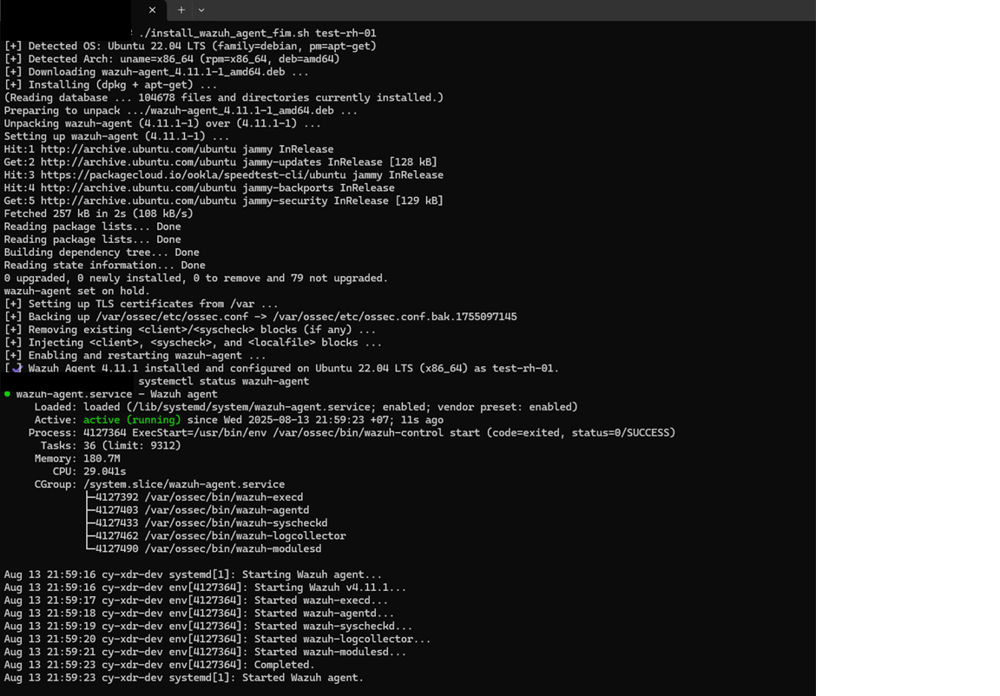
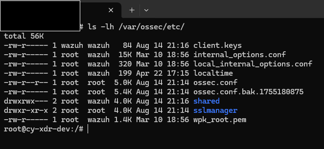
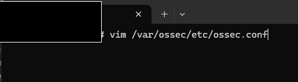
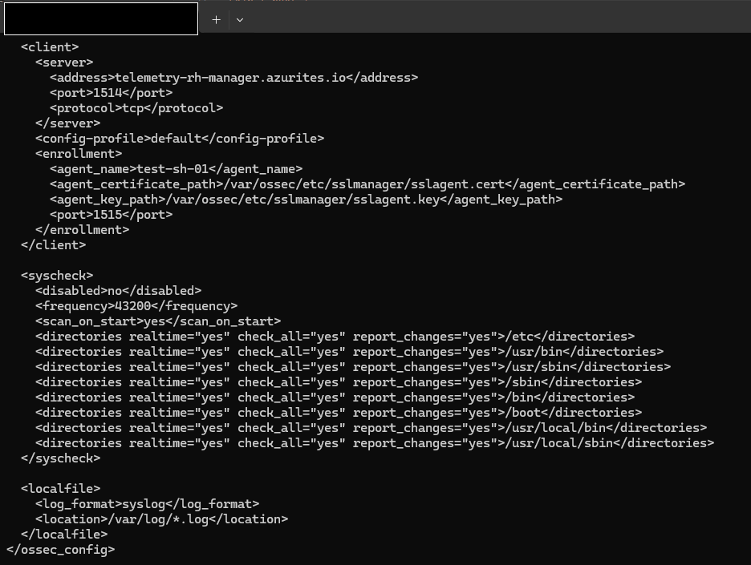

# Wazuh Agent for Linux: Installation, Configuration and Adding More Logs

It documents the installer script itself (`Install_wazuh_agent_fim_v2.sh`), because the original guide only shows how to start it and not what it changes on the host. The screenshots from the Word files are in `image/` and are included below as Figures 1 to 5.

> **Handling.** The manager address is written as `<manager-address>` in the text. It is passed to the installer with the `-wm` option and is not stored in the script (section 3.3). Section 8 lists problems found by reading the scripts. They were not found by running the scripts, so test on one host before rolling out.

---

## Contents

1. [Overview](#1-overview)
2. [Prerequisites](#2-prerequisites)
3. [Installation](#3-installation)
4. [What the installer configures](#4-what-the-installer-configures)
5. [Adding more logs](#5-adding-more-logs)
6. [Uninstallation](#6-uninstallation)
7. [Troubleshooting](#7-troubleshooting)
8. [Notes and known issues](#8-notes-and-known-issues)

---

## 1. Overview

The installer is a single Bash script that installs the Wazuh agent on a Linux host, enrolls it with a Wazuh manager using a TLS client certificate, and turns on file integrity monitoring (FIM) and log collection with sensible defaults.

- **Wazuh agent version:** 4.11.1 by default (override with `WAZUH_VERSION`).
- **Operating systems:** Debian family (Debian, Ubuntu) using `apt-get`, and RHEL family (RHEL, CentOS, Rocky, AlmaLinux, Fedora, Anolis, Amazon Linux) using `dnf` or `yum`.
- **Architectures:** `x86_64` and `aarch64`. `armv7l` is accepted by the script, but Wazuh may not publish a package for it.
- **Init systems:** systemd, with a fallback to SysV `init.d`.

The installer can be run again on the same host. It backs up `ossec.conf` each time and does not duplicate `<localfile>` entries (see section 4.4).

## 2. Prerequisites

1. **Remove any previously installed Wazuh agent completely** (section 6). A leftover agent, key or configuration is the usual cause of enrollment problems.
2. **Run as root, or with `sudo`.** The script uses `sudo` itself when it is not started as root.
3. **Have the certificate and key ready.** Either keep `sslagent.cert` and `sslagent.key` in the same directory as the script, or give the script a download URL (section 3.2).
4. **Network access** from the host to:
   - `packages.wazuh.com` on 443, to download the agent package.
   - the Wazuh manager on **1514/tcp** (agent events) and **1515/tcp** (enrollment).
   - the certificate and key URLs, if you use them.
5. **Tools on the host:** `curl`, `awk` and `od` are required. `openssl` is strongly recommended, because the script uses it to check that the certificate and key are valid and match. `unzip` (or `python3`) is needed only if the certificate arrives in a `.zip`.

## 3. Installation

### 3.1 Prepare the script

Copy `Install_wazuh_agent_fim_v2.sh` to the host, together with the certificate and key if you use local files. The original guide distributes everything as `telemetry_script - linux.zip`. In that case, unzip it and change into the extracted folder first.

If the script was edited or copied from Windows, it may contain carriage returns and fail to start (section 7). Convert it to Unix format. In `vim`, run the following command and then save with `:wq` (Figure 1):

```
:set fileformat=unix
```

*Figure 1: Setting the file format to Unix in vim.*


Or convert it from the shell, which does the same thing:

```bash
sed -i 's/\r//' Install_wazuh_agent_fim_v2.sh
```

Then make the script executable:

```bash
chmod +x Install_wazuh_agent_fim_v2.sh
```

> **File name.** The original guide calls the script `install_wazuh_agent_fim.sh` in lower case. The file in this folder is `Install_wazuh_agent_fim_v2.sh`, with a capital `I`. Linux file names are case-sensitive, so type the name exactly.

### 3.2 Provide the certificate and key

The script checks the certificate and key **before** it installs anything, so a wrong or missing file stops the run early and leaves the host unchanged.

**Option A: local files (default).** Put `sslagent.cert` and `sslagent.key` next to the script. The script also looks in the current directory, in `CERT_SRC_DIR`, and at the paths in `CERT_AGENT_CERT_PATH` and `CERT_AGENT_KEY_PATH`. `sslagent.zip` holds only the certificate, so unzip it and add the key:

```bash
unzip sslagent.zip          # gives sslagent.cert
# copy sslagent.key into the same directory
```

**Option B: download.** Pass an `https://` URL for the certificate with `-certUrl` and, if the key is not in the same download, a second URL for the key with `-certkeyUrl`. The URL can point to a PEM file, or to a `.zip`, `.tar.gz` or `.tgz` archive that holds the certificate and optionally the key.

- Only `https://` URLs are accepted, and they must not contain credentials. Use `-auth` or `URL_AUTH_HEADER` (for example `"Authorization: Bearer <token>"`) or a signed URL instead.
- The URL and header are passed to `curl` through standard input, so they do not appear in the process list.
- Add `CERT_SHA256` and `KEY_SHA256` to pin the expected checksum of each download.
- Use `URL_CACERT` to trust an internal CA for the download.

### 3.3 Run the installer

```bash
sudo ./Install_wazuh_agent_fim_v2.sh -ahost <AGENT_NAME> -wm <MANAGER_ADDRESS> [-certUrl <URL>] [-certkeyUrl <URL>] [-auth <HEADER>]
```

All inputs are named options. There are no positional arguments. Write each option as `-wm value` or `-wm=value`. They can appear in any order, and the option names are not case-sensitive (`-AUTH` and `-certurl` work too).

| Option | Required | Meaning |
|---|---|---|
| `-ahost <AGENT_NAME>` | **Yes** | Name of this agent. Letters, digits, `.`, `-` and `_`, up to 128 characters, starting with a letter or digit. See section 8, note 1: the current script does not yet apply this name |
| `-wm <MANAGER_ADDRESS>` | **Yes** | Host name or IP address (IPv4 or IPv6) of the Wazuh manager, for example `wazuh.example.com` or `203.0.113.10`. Give the address only: no `https://` and no port, because the agent uses 1514/tcp and 1515/tcp. The script checks it before it changes anything on the host. A URL, a `host:port` value, spaces or other special characters are rejected with an error message |
| `-certUrl <URL>` | No | `https://` URL to download the agent certificate from. It can point to a PEM file, or to a `.zip`, `.tar.gz` or `.tgz` archive that holds the certificate and optionally the key. Without it, the certificate is read from local files (section 3.2) |
| `-certkeyUrl <URL>` | No | `https://` URL of the private key (PEM). Not needed when the `-certUrl` download also contains the key, or when `sslagent.key` is available locally |
| `-auth <HEADER>` | No | Request header sent with the `-certUrl` and `-certkeyUrl` downloads. Use a full header line, such as `-auth="Authorization: Bearer <token>"`. A value that does not start with a header name and a colon is sent as the value of the `Authorization` header, so `-auth="Bearer <token>"` gives the same result. It overrides `URL_AUTH_HEADER` |

> **Keep the token off the command line when you can.** A token passed with `-auth` is part of the script's own command line. It is visible in the process list and in shell history, and `sudo` logs the command line. The script keeps the token out of `curl`'s command line, but it cannot hide it from its own. On shared hosts, set `URL_AUTH_HEADER` in the environment instead (last example below).

Examples:

```bash
# Local sslagent.cert and sslagent.key next to the script
sudo ./Install_wazuh_agent_fim_v2.sh -ahost host-01 -wm wazuh.example.com

# Manager given as an IP address
sudo ./Install_wazuh_agent_fim_v2.sh -ahost host-02 -wm 203.0.113.10

# Certificate and key from two URLs
sudo ./Install_wazuh_agent_fim_v2.sh -ahost host-03 -wm wazuh.example.com \
  -certUrl https://files.example.com/agent/sslagent.zip \
  -certkeyUrl https://files.example.com/agent/sslagent.key

# One bundle, with an auth header given as an option, using the -name=value form
sudo ./Install_wazuh_agent_fim_v2.sh -ahost=host-04 -wm=wazuh.example.com \
  -certUrl=https://files.example.com/agent/bundle.zip \
  -auth="Authorization: Bearer $TOKEN"

# The same with the token in the environment, and a pinned checksum
sudo URL_AUTH_HEADER="Authorization: Bearer $TOKEN" \
     CERT_SHA256=<sha256> \
     ./Install_wazuh_agent_fim_v2.sh -ahost host-05 -wm wazuh.example.com \
     -certUrl https://files.example.com/agent/bundle.zip
```

> **Changed usage.** Earlier versions of the script took the agent name and the URLs as positional arguments and used a manager address built into the script. A call written for them, such as `host-01 https://files.example.com/...`, is not accepted: the script stops with "Unexpected argument" before it changes anything. Add the option names `-ahost`, `-wm`, `-certUrl` and `-certkeyUrl`.

Environment variables that change the behavior:

| Variable | Default | Meaning |
|---|---|---|
| `WAZUH_VERSION` | `4.11.1` | Agent package version to download |
| `CERT_URL`, `KEY_URL` | none | Used when `-certUrl` and `-certkeyUrl` are not given. The options take priority |
| `URL_AUTH_HEADER` | none | One-line extra header for the downloads. The `-auth` option does the same and takes priority |
| `URL_CACERT` | none | CA bundle for the download |
| `CERT_SHA256`, `KEY_SHA256` | none | Expected SHA-256 of each download |
| `CERT_SRC_DIR` | script directory | Extra directory searched for the local files |
| `CERT_AGENT_CERT_PATH`, `CERT_AGENT_KEY_PATH` | none | Exact paths of the local certificate and key |
| `SSL_AGENT_CERT_NAME`, `SSL_AGENT_KEY_NAME` | `sslagent.cert`, `sslagent.key` | File names to look for |

Run `./Install_wazuh_agent_fim_v2.sh --help` to print the same usage text.

### 3.4 Check the result

A successful run detects the OS and architecture, downloads and installs the package, configures the agent and ends with the `wazuh-agent` service active (Figure 2).

*Figure 2: Example output on Ubuntu 22.04, taken from an earlier version of the script (see section 8, note 1).*



Then confirm on the host:

```bash
sudo systemctl status wazuh-agent
sudo tail -n 50 /var/ossec/logs/ossec.log
sudo grep -i "connected to the server" /var/ossec/logs/ossec.log
```

Finally, confirm that the agent appears in the Wazuh manager. If the agent is running but never connects, check the manager address and ports 1514 and 1515 first, then the certificate and key (section 7).

## 4. What the installer configures

### 4.1 Order of operations

1. Detect the OS family, package manager and CPU architecture.
2. **Fetch and validate the certificate and key** (download, or local lookup). It checks that both are valid PEM files, that the key is not password-protected, that the key matches the certificate, and warns if the certificate has expired.
3. Download the agent package (`.deb` or `.rpm`) from `packages.wazuh.com` and install it. On Debian-family hosts it then runs `apt-mark hold wazuh-agent`, so a routine `apt upgrade` does not change the version.
4. Copy the certificate and key to `/var/ossec/etc/sslmanager/` and set permissions (section 4.3). On SELinux hosts it relabels the folder with `restorecon`.
5. Back up `/var/ossec/etc/ossec.conf` to `ossec.conf.bak.<timestamp>`.
6. Rewrite the `<client>` and `<syscheck>` blocks and add the `<localfile>` entries (sections 4.2 and 4.4).
7. Validate `ossec.conf` with `xmllint` or `xmlstarlet` when either is installed.
8. Enable and restart `wazuh-agent`, then print the service status and the last 200 lines of `ossec.log`.

### 4.2 Configuration written to `ossec.conf`

| Block | Setting |
|---|---|
| `<client><server>` | The `-wm` value, port `1514`, protocol `tcp` |
| `<client><enrollment>` | Certificate `/var/ossec/etc/sslmanager/sslagent.cert`, key `/var/ossec/etc/sslmanager/sslagent.key`, enrollment port `1515` |
| `<syscheck>` | Enabled, scan every `43200` seconds (12 hours), scan on start |
| FIM directories (real time, all checks) | `/etc`, `/usr/bin`, `/usr/sbin`, `/sbin`, `/bin`, `/boot`, `/usr/local/bin`, `/usr/local/sbin` |
| FIM change reporting | `report_changes="yes"` on `/etc` only |

Figure 5 in section 5 shows this configuration in the file.

### 4.3 Permissions

| Path | Owner | Mode |
|---|---|---|
| `/var/ossec/etc/sslmanager/` | `wazuh:wazuh` | `700` |
| `/var/ossec/etc/sslmanager/sslagent.cert`, `sslagent.key` | `wazuh:wazuh` | `600` |
| `/var/ossec/etc/ossec.conf` | `root:wazuh` | `640` |

### 4.4 Log collection (`<localfile>` entries)

If `systemd-journald` is running, the script first adds a native `journald` input. It then adds the file locations for the distribution, in this order, all with `log_format` `syslog`. A location that is already present in `ossec.conf` is skipped, so running the script twice does not create duplicates.

| Distribution | Locations |
|---|---|
| Debian, Ubuntu | `/var/log/*.log`, `/var/log/wtmp`, `/var/log/syslog`, `/var/log/lastlog` |
| Amazon Linux | `/var/log/*.log`, `/var/log/wtmp`, `/var/log/lastlog`, `/var/log/secure` |
| CentOS 9 | `/var/log/*.log`, `/var/log/wtmp`, `/var/log/lastlog` |
| Other RHEL family (CentOS 6, 7 and 8, RHEL, Rocky, AlmaLinux and so on) | `/var/log/*.log`, `/var/log/wtmp`, `/var/log/secure`, `/var/log/messages`, `/var/log/lastlog` |

Re-running the installer **keeps** any `<localfile>` entries you added by hand, but it **replaces** the whole `<client>` and `<syscheck>` blocks. Make custom changes to those two blocks again after a re-run, or keep them out of the script's way.

## 5. Adding more logs

By default the agent reads the files in section 4.4. To collect another log, such as OpenVPN, add a `<localfile>` entry that points to it.

**Step 1: Check the permissions of the agent configuration.** The agent files are in `/var/ossec/etc/`. Pay particular attention to `ossec.conf` and to the `sslmanager` folder, which must contain `sslagent.cert` and `sslagent.key`. Wrong permissions here were behind the problems met in earlier installations. Use the values in section 4.3 as the target.

```bash
ls -lh /var/ossec/etc/
```

*Figure 3: Listing of `/var/ossec/etc/` from a test host. This host was installed with an earlier script version, which left `ossec.conf` as `root:root 644` and `sslmanager` as `root:root 755`. The current script sets the stricter values in section 4.3.*



**Step 2: Open the agent configuration for editing.** Make a backup first.

```bash
sudo cp -a /var/ossec/etc/ossec.conf /var/ossec/etc/ossec.conf.bak.manual
sudo vim /var/ossec/etc/ossec.conf
```

*Figure 4: Opening `ossec.conf` in vim.*



**Step 3: Add a `<localfile>` tag for each extra log.** Place it inside `<ossec_config>`, before the closing `</ossec_config>` line, next to the existing `<localfile>` entries. For OpenVPN:

```xml
<localfile>
  <log_format>syslog</log_format>
  <location>/var/log/openvpn/openvpn.log</location>
</localfile>
```

*Figure 5: The `<client>`, `<syscheck>` and `<localfile>` blocks at the end of `ossec.conf` after installation. This screenshot is from an earlier script version, which also wrote `<agent_name>` and set `report_changes` on every FIM directory. Add new `<localfile>` entries below the existing one.*



> **Caution.** The file path must exist and be correct, and the agent must have permission to read the file. A wrong or non-existent path causes errors in the agent, and the agent may malfunction if too many errors are triggered.

The original guide writes the OpenVPN path as `/var/logs/openvpn/openvpn.log`. Most systems log to `/var/log/` (singular), so the example above uses that. OpenVPN's log location depends on its `log` or `log-append` setting, so confirm the real path first:

```bash
sudo grep -rE "^(log|log-append|status) " /etc/openvpn/ 2>/dev/null
ls -l /var/log/openvpn/
```

**Step 4: Check and restart.**

```bash
sudo xmllint --noout /var/ossec/etc/ossec.conf    # only if xmllint is installed
sudo systemctl restart wazuh-agent
sudo grep -i "openvpn" /var/ossec/logs/ossec.log   # expect an "Analyzing file" line
sudo tail -n 50 /var/ossec/logs/ossec.log          # look for ERROR or WARNING lines
```

**Choosing `log_format`.** `syslog` suits most plain-text, one-line-per-event logs. For other kinds of logs, use the matching format:

| `log_format` | Use for |
|---|---|
| `syslog` | Standard text logs such as OpenVPN, `auth.log`, `messages` |
| `json` | Logs where each line is a JSON object |
| `apache` | Apache access and error logs |
| `audit` | The Linux audit log (`/var/log/audit/audit.log`) |
| `multi-line:<N>` | Events that always span exactly N lines |

A `<location>` can use wildcards, for example `/var/log/openvpn/*.log`.

## 6. Uninstallation

The readme refers to a `wazuh_uninstall.sh` script, but that script is **not in this folder**. Remove the agent manually instead.

**Debian, Ubuntu.** The installer holds the package, so release the hold first:

```bash
sudo systemctl stop wazuh-agent
sudo systemctl disable wazuh-agent
sudo apt-mark unhold wazuh-agent
sudo apt-get remove --purge -y wazuh-agent
sudo systemctl daemon-reload
```

**RHEL family:**

```bash
sudo systemctl stop wazuh-agent
sudo systemctl disable wazuh-agent
sudo dnf remove -y wazuh-agent        # or: sudo yum remove -y wazuh-agent
sudo systemctl daemon-reload
```

Afterwards, check whether `/var/ossec` still exists. It can hold the old `client.keys` and the TLS key in `sslmanager/`. Look at what is there before deleting it. Also remove the agent from the manager, otherwise the old registration stays in the agent list.

## 7. Troubleshooting

| Symptom | Likely cause | Fix |
|---|---|---|
| `File not found`, `bad interpreter` or `env: 'bash\r'` when running the script | Windows line endings (carriage returns). The `v1_fixed` script has them | `sed -i 's/\r//' <script>.sh`, or `:set fileformat=unix` in vim (section 3.1) |
| `Permission denied` | The script is not executable or you are not root | `chmod +x <script>.sh` and run with `sudo` |
| `command not found` for the script | Wrong case in the name, or missing `./` | Use `./Install_wazuh_agent_fim_v2.sh` exactly |
| `[!] TLS files not found.` | No certificate or key was found | Put both files next to the script, set `CERT_AGENT_CERT_PATH` and `CERT_AGENT_KEY_PATH`, or pass `-certUrl` and `-certkeyUrl` |
| `The private key does not match the certificate.` | The two files belong to different pairs | Get the matching pair from the same source |
| `... is not a readable PEM private key` | The key is encrypted or not PEM | Use an unencrypted PEM key, the agent cannot use a password-protected one |
| `... must be an https:// URL without credentials` | An `http://` URL, or `user:pass@host` in the URL | Use `https://` and pass credentials with `-auth` or `URL_AUTH_HEADER` |
| `... is not a PEM file, .zip or .tar.gz (is the URL a login or error page?)` | The URL returned an HTML page instead of the file | Check the URL and the token |
| `SHA-256 mismatch` | The download is not the file you pinned | Do not continue. Check the source and the checksum |
| Service is running but the agent never appears on the manager | Manager address or ports wrong, firewall, or an old registration | Check the `-wm` value you passed, ports 1514 and 1515, and `ossec.log`. Remove old registrations (section 6) |
| `[!] The agent name is missing.` or `[!] The Wazuh manager address is missing.` | `-ahost` or `-wm` was left out | Add `-ahost <AGENT_NAME>` and `-wm <MANAGER_ADDRESS>` (section 3.3) |
| `[!] Unexpected argument. All inputs are named options` | A value without an option name, such as an old-style call `host-01 https://...` | Put an option name in front of every value: `-ahost`, `-wm`, `-certUrl`, `-certkeyUrl`, `-auth` |
| `[!] The -ahost value is not a valid agent name` | The name has spaces or special characters, or `-ahost` had no value and took the next option as its value | Use letters, digits, `.`, `-` and `_` only |
| `[!] The -wm value must be a host name or IP address, not a URL` or `... is not a valid host name or IP address` | The value is a URL, has a port (`host:1514`), spaces or special characters | Pass the host name or IP address only |
| `[!] -wm needs a value.` (or another option), `[!] ... was given more than once.` or `[!] Unknown option: ...` | An option with no value, repeated, or misspelled | Use `-wm <value>` or `-wm=<value>`, once each. The options are `-ahost`, `-wm`, `-certUrl`, `-certkeyUrl` and `-auth` |
| `[!] The -auth header has a name but no value.` | `-auth="Authorization:"` with nothing after the colon | Give the whole header: `-auth="Authorization: Bearer <token>"` |
| Errors in `ossec.log` after adding a log | Path wrong or file not readable | Fix the `<location>` (section 5), then restart the agent |

## 8. Notes and known issues

These were found by reading the scripts and documents in this folder. They were not found by running them. They are listed so that the guide matches what the scripts do, not to change the scripts.

1. **The agent name is not used.** Both scripts require an agent name (`-ahost` in `Install_wazuh_agent_fim_v2.sh`, the first argument in `v1_fixed`), but the value is stored in `WAZUH_AGENT_NAME` and never used. It is not passed to the package installer and not written to `<agent_name>` in `ossec.conf`. Wazuh then falls back to the host name. The older script that produced Figures 2 and 5 did set the name (`test-rh-01`, `test-sh-01`). **Fix:** run the package install with `WAZUH_AGENT_NAME="$WAZUH_AGENT_NAME"` in the environment, or add `<agent_name>${WAZUH_AGENT_NAME}</agent_name>` to the `<enrollment>` block.
2. **`wazuh_uninstall.sh` is missing.** The readme tells you to run it, but it is not in the folder. Use section 6, or add the script.
3. **The `OSSEC_*` overrides do nothing.** `OSSEC_CONF_MODE`, `OSSEC_ETC_MODE`, `OSSEC_CONF_GROUP_RWX` and `OSSEC_DEPTH` are defined, but `set_permissions` uses fixed values (section 4.3).
4. **Permissions in the old diagram differ from the current script.** Figure 3 shows `ossec.conf` as `root:root 644` and `sslmanager` as `root:root 755`. The current script sets `root:wazuh 640` and `wazuh:wazuh 700`. Treat section 4.3 as the target.
5. **`/var/log/wtmp` and `/var/log/lastlog` are binary files.** The script collects them with `log_format` `syslog`, which expects text lines. They probably produce little useful output. This was not tested, so check what reaches the manager before relying on them.
6. **`sslagent.zip` has the certificate only.** The private key has to be delivered separately, and the readme does not say how.
7. **The version is pinned.** `4.11.1` is the default and Debian-family hosts are put on `apt-mark hold`. To upgrade, set `WAZUH_VERSION`, run `apt-mark unhold wazuh-agent`, and re-run the installer.
8. **The `set -euo pipefail` line is commented out.** The script continues after many non-critical errors on purpose (`|| true`), so read the output and `ossec.log` instead of relying on the exit code alone.
9. **The OpenVPN path in the original guide was `/var/logs/...`.** It is corrected to `/var/log/openvpn/openvpn.log` here (section 5). Confirm it against your OpenVPN configuration.
