# Windows Log Auditing Configuration: Group Policy Guide and Automation Scripts

This document combines the two sources in this folder into one reference:

1. **The configuration guide** (`WindowsLogAuditingConfiguration_v2.0A.docx` and `.pdf`), a step-by-step Group Policy procedure with screenshots, covering 14 event-ID topics plus a file and folder auditing step.
2. **The automation script** (`PowerShellAuditLogging.ps1` and its launcher `PowerShellAuditLogging.bat`), a single script that applies the same settings locally. It replaces the earlier `ScriptEventLog.ps1` and `Invoke-CYNPowerShellAuditLogging.ps1`, which are kept in `old/`.

For every event ID it shows what to enable, where the setting lives in Group Policy, and which script applies it. Section 6 records a review of the original scripts against the guide and shows which problems the merged script fixes.

> **Handling.** The Word and PDF files are the same guide (version 2.0, 57 pages) in two formats. A text comparison found no differences in the steps, so they are treated as one source. Selected screenshots from the guide are included in section 4. Screenshots that show a lab domain name were left out, the Transcription screenshot is edited to show `C:\logs` (see Figure 4), and the full set stays in the Word and PDF files. The classification marking and author details on the original cover page are intentionally not carried over.

---

## Contents

1. [Scope and prerequisites](#1-scope-and-prerequisites)
2. [Files in this folder](#2-files-in-this-folder)
3. [Event coverage](#3-event-coverage)
4. [Manual configuration with Group Policy](#4-manual-configuration-with-group-policy)
5. [Automation scripts](#5-automation-scripts)
6. [Script review](#6-script-review)
7. [Verification](#7-verification)

---

## 1. Scope and prerequisites

- **Goal:** record the Windows events needed for account, logon, object access, process, Kerberos, PowerShell and DHCP monitoring, so they can be collected into a SIEM.
- **Where to apply the policy:**
  - Domain-wide settings belong in a **Group Policy Object** (GPO), edited with the Group Policy Management Editor under *Computer Configuration → Policies*. This is what the guide documents.
  - The scripts change **local** settings. A domain GPO that defines the same settings will overwrite them at the next policy refresh, so use the scripts on standalone or test hosts.
  - Events 4768, 4769 and 4770 are generated on **domain controllers** only, so member servers and workstations will not produce the Kerberos ticket events. Event 4776 is logged by the machine that validates the credentials, which is a domain controller for domain accounts.
- **Rights:** local administrator for the scripts, and GPO edit rights for the guide.
- **Volume warning:** File System, Registry, SAM, Handle Manipulation, Kernel Object and Removable Storage auditing with *Success and Failure* is very noisy. Size the Security log and the log collector for it.

## 2. Files in this folder

| File | Purpose |
|---|---|
| `WindowsLogAuditingConfiguration_v2.0A.docx` / `.pdf` | The Group Policy guide with screenshots |
| `PowerShellAuditLogging.bat` | Launcher. Checks for administrator rights, then runs `PowerShellAuditLogging.ps1` |
| `PowerShellAuditLogging.ps1` | The single script: advanced audit policy, process command line, PowerShell logging, transcript folder and a self-check. It also holds the function `Invoke-PowerShellAuditLogging` |
| `old/` | The superseded originals: `ScriptEventLog.bat`, `ScriptEventLog.ps1`, `Invoke-CYNPowerShellAuditLogging.ps1` and its readme. Kept for comparison, not used |

## 3. Event coverage

"GPO path" is under *Computer Configuration → Policies*. The section numbers follow the guide.

| # | Event ID | What it records | Setting | GPO path | Script |
|---|---|---|---|---|---|
| 1 | 4104 | PowerShell script block executed | Script Block Logging, Module Logging, Transcription | Administrative Templates → Windows Components → Windows PowerShell | `-Method ScriptBlockLogging`, `ModuleLogging`, `TranscriptLogging` (all run by default) |
| 2 | 4720 | User account created | Audit User Account Management | Windows Settings → Security Settings → Advanced Audit Policy Configuration → Audit Policies → Account Management | `Set-AuditPolicy` |
| 3 | 4624 | Successful logon | Audit Logon | … → Logon/Logoff | `Set-AuditPolicy` |
| 4 | 4625 | Failed logon | Audit Logon | … → Logon/Logoff | `Set-AuditPolicy` |
| 5 | 4648 | Logon with explicit credentials | Audit Logon | … → Logon/Logoff | `Set-AuditPolicy` |
| 6 | 4776 | Credential validation by the domain controller | Audit Credential Validation | … → Account Logon | `Set-AuditPolicy` |
| 7 | 4656 | Handle to an object requested | Audit File System, Registry, SAM, Handle Manipulation, Removable Storage | … → Object Access | `Set-AuditPolicy` |
| 8 | 4663 | Access to an object attempted | Audit Kernel Object (and File System, Registry) | … → Object Access | `Set-AuditPolicy` |
| 9 | 4698 | Scheduled task created | Audit Other Object Access Events | … → Object Access | `Set-AuditPolicy` |
| 10 | 4688 | New process created | Audit Process Creation, plus *Include command line in process creation events* | … → Detailed Tracking, and Administrative Templates → System → Audit Process Creation | `Set-AuditPolicy`; `-Method ProcessCreateWithCmdline` |
| 11 | 4768 | Kerberos TGT requested | Audit Kerberos Authentication Service | … → Account Logon | `Set-AuditPolicy` |
| 12 | 4769 | Kerberos service ticket requested | Audit Kerberos Service Ticket Operations | … → Account Logon | `Set-AuditPolicy` |
| 13 | 4770 | Kerberos service ticket renewed | Audit Kerberos Service Ticket Operations | … → Account Logon | `Set-AuditPolicy` |
| 14 | n/a | DHCP server activity | DHCP audit logging (IPv4 and IPv6) | DHCP console | **Not scripted** |
| Extra | n/a | File and folder access on a sensitive path | File System audit entry (SACL) | Windows Settings → Security Settings → File System | **Not scripted** |

Events 3 to 5 share the single *Audit Logon* subcategory, and events 12 and 13 share *Audit Kerberos Service Ticket Operations*, so one policy setting produces several event IDs. The guide also groups events 7 to 9 together, but they come from several Object Access subcategories.

## 4. Manual configuration with Group Policy

Open the GPO in the Group Policy Management Editor, then work under *Computer Configuration → Policies*.

### 4.1 PowerShell logging (event 4104)

Path: *Administrative Templates → Windows Components → Windows PowerShell*.

1. **Turn on Module Logging:** set *Enabled*, choose *Show…*, add the module names `Microsoft.PowerShell.*` and `Microsoft.WSMan.Management`, then *Apply* and *OK*.
2. **Turn on PowerShell Script Block Logging:** set *Enabled*, *Apply*, *OK*.
3. **Turn on PowerShell Transcription:** set *Enabled*, enter the directory for the transcript logs (the script uses `C:\logs`), *Apply*, *OK*.

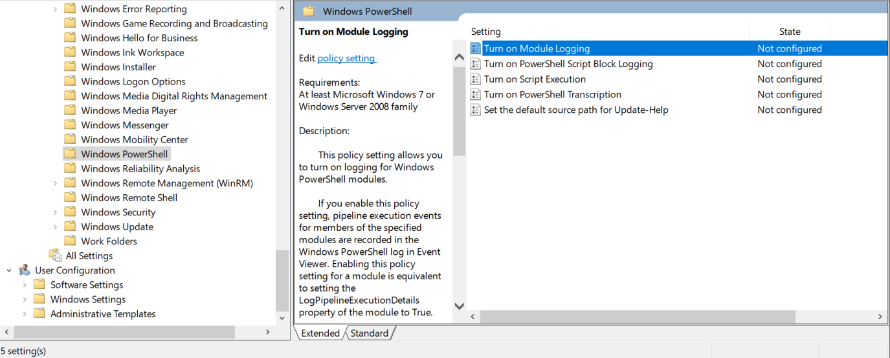

**Figure 1.** The Windows PowerShell policy folder (*Administrative Templates → Windows Components → Windows PowerShell*), with the Module Logging, Script Block Logging and Transcription settings.

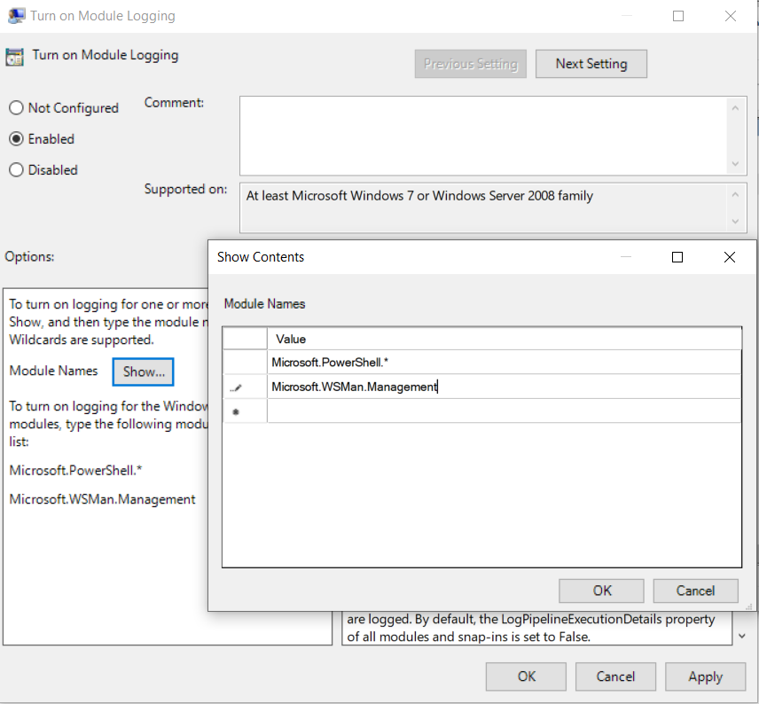

**Figure 2.** *Turn on Module Logging* set to Enabled, with the module names `Microsoft.PowerShell.*` and `Microsoft.WSMan.Management` in the *Show Contents* window.

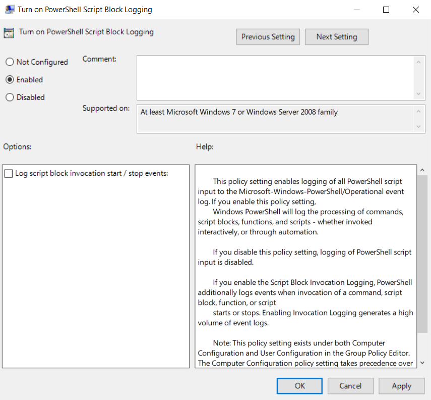

**Figure 3.** *Turn on PowerShell Script Block Logging* set to Enabled.

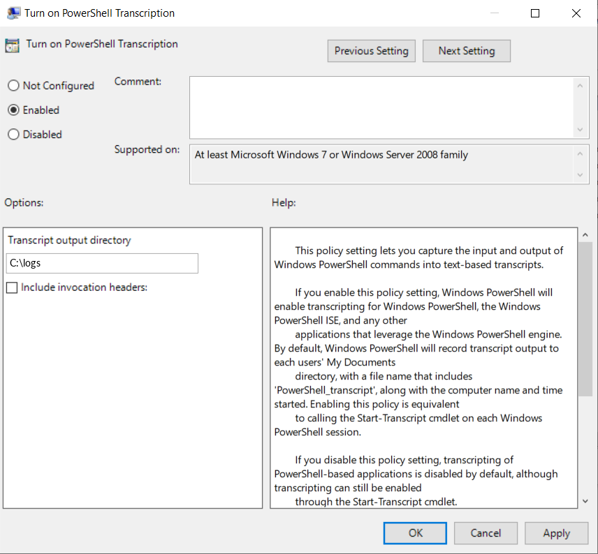

**Figure 4.** *Turn on PowerShell Transcription* set to Enabled, with the transcript output directory `C:\logs`. The guide's original screenshot showed a different example path. This image is edited to show the path the script uses.

### 4.2 Advanced audit policies (events 4720, 4624, 4625, 4648, 4776, 4656, 4663, 4698, 4688, 4768, 4769, 4770)

Path: *Windows Settings → Security Settings → Advanced Audit Policy Configuration → Audit Policies*. For each subcategory below, double-click it, tick **Configure the following audit events**, select **Success** and **Failure**, then *Apply* and *OK*.

| Category | Subcategories to configure |
|---|---|
| Account Management | Audit User Account Management |
| Logon/Logoff | Audit Logon |
| Account Logon | Audit Credential Validation; Audit Kerberos Authentication Service; Audit Kerberos Service Ticket Operations |
| Object Access | Audit File System; Audit Registry; Audit SAM; Audit Handle Manipulation; Audit Removable Storage; Audit Kernel Object; Audit Other Object Access Events |
| Detailed Tracking | Audit Process Creation |

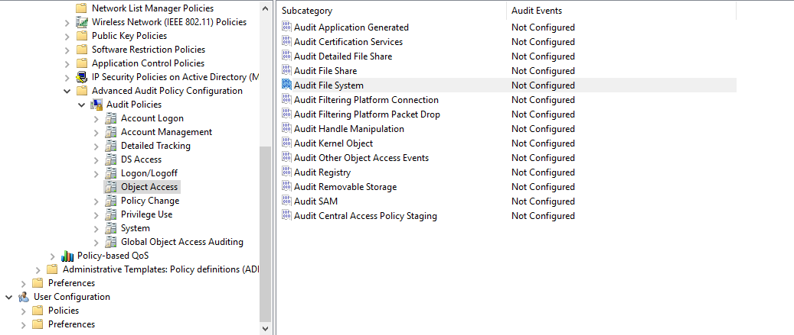

**Figure 5.** *Advanced Audit Policy Configuration → Audit Policies → Object Access* and its subcategories.

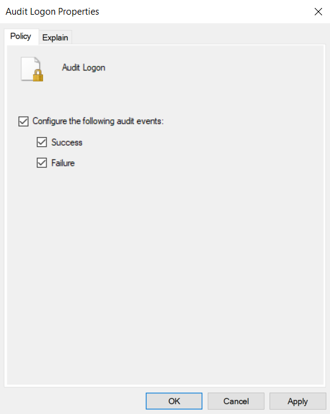

**Figure 6.** Every subcategory is configured the same way: tick *Configure the following audit events*, then *Success* and *Failure*. Shown for *Audit Logon*.

### 4.3 Include the command line in process creation events (event 4688)

Path: *Administrative Templates → System → Audit Process Creation → Include command line in process creation events*. Set *Enabled*, *Apply*, *OK*.

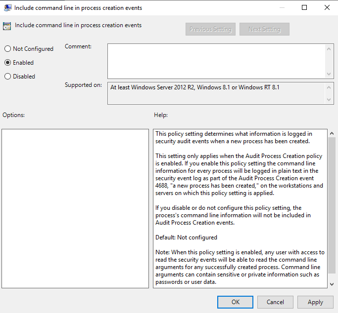

**Figure 7.** *Include command line in process creation events* set to Enabled.

### 4.4 DHCP server logging

1. In Server Manager choose *Tools → DHCP*, then expand the DHCP server.
2. Right-click **IPv4**, choose *Properties*. On the *General* tab tick **Enable DHCP audit logging**. On the *Advanced* tab set the audit log directory. *Apply*, *OK*.
3. Repeat for **IPv6**.

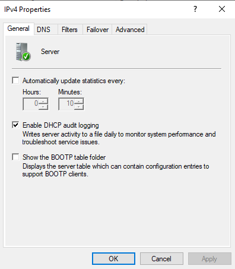

**Figure 8.** IPv4 Properties, *General* tab: *Enable DHCP audit logging*.

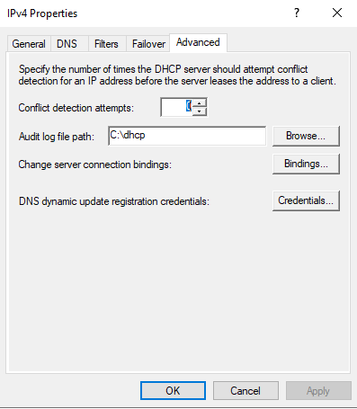

**Figure 9.** IPv4 Properties, *Advanced* tab: the audit log file path.

### 4.5 File and folder access audit on a sensitive path

Path: *Windows Settings → Security Settings → File System*.

1. Right-click *File System*, choose *Add File…*, and select the path to audit. The guide uses the `lsass` binary in `C:\Windows\System32`. The file on disk is `lsass.exe`, so confirm the path before applying.
2. Choose *Advanced → Auditing → Add → Select a principal*, enter `Everyone`, and press *OK*.
3. Set *Type* to **All** and the permission to **Full Control**, then *OK*, *Apply*, *OK*.

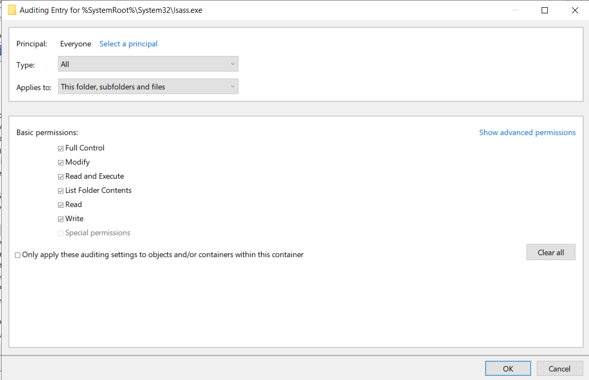

**Figure 10.** The audit entry: principal *Everyone*, *Type* **All**.

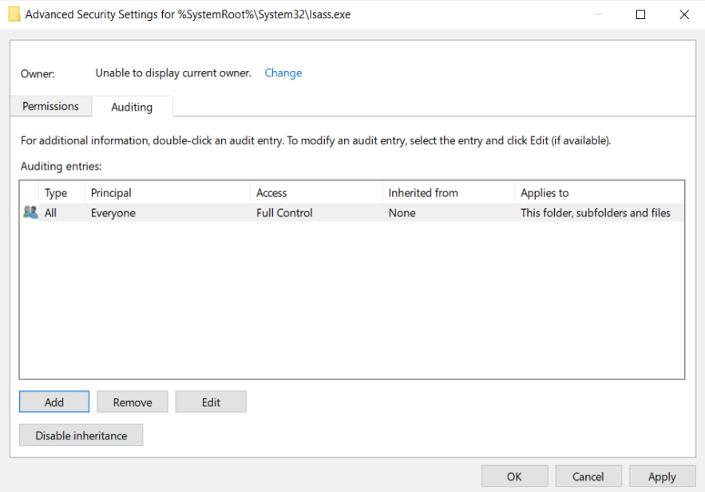

**Figure 11.** The resulting auditing entry for `lsass.exe`: *Everyone*, *All*, *Full Control*.

Auditing File System and Registry subcategories only produces events for objects that have an audit entry (SACL), so this step is what makes the object access events useful.

## 5. Automation script

`PowerShellAuditLogging.ps1` applies the guide's settings on the local machine. Running it with no parameters does everything:

1. **Advanced audit policy.** `auditpol` enables Success and Failure for the 13 subcategories in section 4.2, one line per subcategory, with the result of each.
2. **Process command line.** Sets `ProcessCreationIncludeCmdLine_Enabled = 1` (section 4.3).
3. **PowerShell logging.** Script Block Logging, Module Logging and Transcription for Windows PowerShell, plus Script Block Logging for PowerShell 7. The settings are written to the native policy key and to the 32-bit `Wow6432Node` key.
4. **Transcript folder.** Creates `C:\logs` and limits it to Administrators and SYSTEM. Transcripts and the `OutputDirectory` policy point to it.
5. **Self-check.** Starts a new Windows PowerShell session with a unique marker and looks for its event 4104 in `Microsoft-Windows-PowerShell/Operational`.

The script exits with code 0 on success and 1 if any step failed, so a scheduler or the launcher can react.

### 5.1 Running it

Right-click `PowerShellAuditLogging.bat` and choose *Run as administrator*. The launcher checks for elevation, runs the script with `-ExecutionPolicy Bypass` for that one process, shows the output, waits 10 seconds and returns the script's exit code. Extra arguments are passed on:

```bat
PowerShellAuditLogging.bat -Method AuditPolicy
PowerShellAuditLogging.bat -TranscriptLogPath D:\logs
```

From an elevated PowerShell, run the script directly:

```powershell
powershell -ep bypass
.\PowerShellAuditLogging.ps1
```

Dot-source the file to load the function without running anything:

```powershell
. .\PowerShellAuditLogging.ps1
Invoke-PowerShellAuditLogging -Method DisableAllLogging
```

### 5.2 Parameters

| Parameter | Default | Meaning |
|---|---|---|
| `-Method` | `ApplyAll` | What to do (table below) |
| `-TranscriptLogPath` | `C:\logs` | Transcript folder and the `OutputDirectory` policy value |
| `-SkipTranscriptAcl` | off | Leave the folder's permissions unchanged. Use it when `C:\logs` is shared with other logs |

| `-Method` | Effect |
|---|---|
| `ApplyAll` | Audit policy plus everything in `EnableAllLogging` |
| `AuditPolicy` | Audit policy only |
| `ScriptBlockLogging`, `ModuleLogging`, `TranscriptLogging` | One Windows PowerShell logging feature |
| `EnableAllLogging` | All PowerShell logging, process command line, PowerShell 7 script block logging, and the self-check |
| `DisableAllLogging` | Removes the policy values. **The log folder and existing transcripts are kept** |
| `ProcessCreateWithCmdline` | Process creation auditing with the command line |
| `Pwsh7ScriptBlockLogging`, `Pwsh7ModuleLogging`, `Pwsh7TranscriptLogging` | The same features for PowerShell 7 |
| `InstallPwSh7` | Downloads and installs PowerShell 7 with Microsoft's install script |

Module Logging logs every module (`*`). The guide lists `Microsoft.PowerShell.*` and `Microsoft.WSMan.Management`. To follow the guide, change the list `$script:ModuleLoggingNames` near the top of the script.

### 5.3 What changed from the original scripts

| Area | Change |
|---|---|
| Files | `ScriptEventLog.ps1` and `Invoke-CYNPowerShellAuditLogging.ps1` merged into `PowerShellAuditLogging.ps1`. `ScriptEventLog.bat` replaced by `PowerShellAuditLogging.bat`. The originals are in `old/` |
| Output directory | Transcripts go to `C:\logs`. The old defaults were `C:\transcriptPS\` and `C:\Securitylogs\pstransactions\` |
| Naming | The `CYN` prefix is gone. The main function is now `Invoke-PowerShellAuditLogging`. The helpers use the prefix `PSAudit`, for example `Invoke-PSAuditScriptBlockLogging`. The parameter `-TransactionLogPath` is now `-TranscriptLogPath` |
| Launcher | The `.bat` runs the single script, checks for administrator rights, passes arguments on and returns the exit code |
| Fixes | The native registry key is now written as well as the 32-bit one (64-bit PowerShell ignores the 32-bit key alone), `DisableAllLogging` removes the command-line value and no longer deletes the folder, the PowerShell 7 module names go to the `ModuleNames` key, and every step is checked with an administrator check and an exit code |

Function names, old to new:

| Original | Merged script |
|---|---|
| `Invoke-CYNPowerShellAuditLogging` | `Invoke-PowerShellAuditLogging` |
| `Invoke-CYNScriptBlockLogging`, `Invoke-CYNModuleLogging`, `Invoke-CYNTranscriptLogging` | `Invoke-PSAuditScriptBlockLogging`, `Invoke-PSAuditModuleLogging`, `Invoke-PSAuditTranscriptLogging` |
| `Invoke-CYNPS7ScriptBlockLogging`, `Invoke-CYNPS7ModuleLogging`, `Invoke-CYNPS7TranscriptLogging` | `Invoke-PSAuditPS7ScriptBlockLogging`, `Invoke-PSAuditPS7ModuleLogging`, `Invoke-PSAuditPS7TranscriptLogging` |
| `Invoke-CYNProcessCreationIncludeCmdLine` | `Invoke-PSAuditProcessCreationCmdLine` |
| `Invoke-CYNPSLogging` | `Invoke-PSAuditAllLogging` |
| `Invoke-CYNDisableAllLogging` | `Invoke-PSAuditDisableAllLogging` |
| `Invoke-CYNCheck` | `Invoke-PSAuditCheck` |
| `Get-PwSh7` | `Install-PwSh7` |

## 6. Script review

**Method and limits.** The original scripts were reviewed against the guide, then the merged script was checked:

- It parses without errors in PowerShell 7.4, and PSScriptAnalyzer reports only style warnings (`Invoke-Expression` in the PowerShell 7 installer, and `ShouldProcess` support).
- Its logic was run against mocked registry, ACL and `auditpol` calls: the audit policy loop reports a failing subcategory, `EnableAllLogging` writes the expected keys with `C:\logs`, `DisableAllLogging` removes them without touching the folder, and `-SkipTranscriptAcl` leaves permissions alone.
- It has **not been run on Windows**. Items marked *test* need confirming on a lab machine.

Writing both registry keys rests on how the 64-bit and 32-bit registry views work and on Microsoft's [about_logging](https://learn.microsoft.com/powershell/module/microsoft.powershell.core/about/about_logging) page, which uses the native policy path.

**What was already correct.** All 13 `auditpol` subcategory names match the guide. The command-line setting used the right key and value. The idea of a built-in 4104 check was sound.

### 6.1 Things to know before using `C:\logs`

- By default the script restricts `C:\logs` to Administrators and SYSTEM and **removes inheritance**. If other applications write to `C:\logs`, run with `-SkipTranscriptAcl`, or choose a dedicated folder such as `C:\logs\powershell`.
- PowerShell writes transcripts into dated subfolders (for example `C:\logs\20251105\`).
- Transcripts can contain typed secrets, so keep read access limited and forward them to your log collector.
- Transcripts are written under the user's own account. With the default permissions (Administrators and SYSTEM only), transcripts of standard users may not be written, so test with a standard user.

## 7. Verification

Run these from an elevated PowerShell after applying either method.

```powershell
# Audit policy actually in effect
auditpol /get /category:*

# PowerShell policy values in the native (64-bit) key; OutputDirectory should be C:\logs
Get-ItemProperty 'HKLM:\SOFTWARE\Policies\Microsoft\Windows\PowerShell\ScriptBlockLogging'
Get-ItemProperty 'HKLM:\SOFTWARE\Policies\Microsoft\Windows\PowerShell\Transcription'

# Command-line setting for event 4688
Get-ItemProperty 'HKLM:\SOFTWARE\Microsoft\Windows\CurrentVersion\Policies\System\Audit'

# Run a harmless script block, then look for event 4104
Get-Date; Start-Sleep 2
Get-WinEvent -FilterHashtable @{ LogName = 'Microsoft-Windows-PowerShell/Operational'; Id = 4104 } -MaxEvents 3

# Event 4688: the message should include a Process Command Line
Get-WinEvent -FilterHashtable @{ LogName = 'Security'; Id = 4688 } -MaxEvents 3

# Log sizes
wevtutil gl Security | Select-String maxSize
```

The script already runs the 4104 check for you. If the `4104` query returns nothing on a 64-bit host after running the *original* scripts in `old/`, the cause is that they wrote only the 32-bit registry key.
